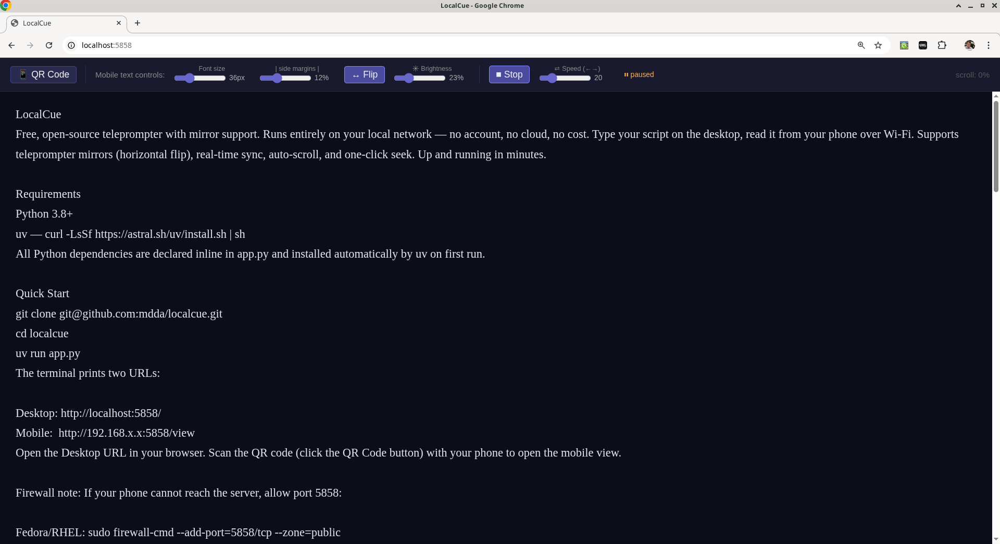
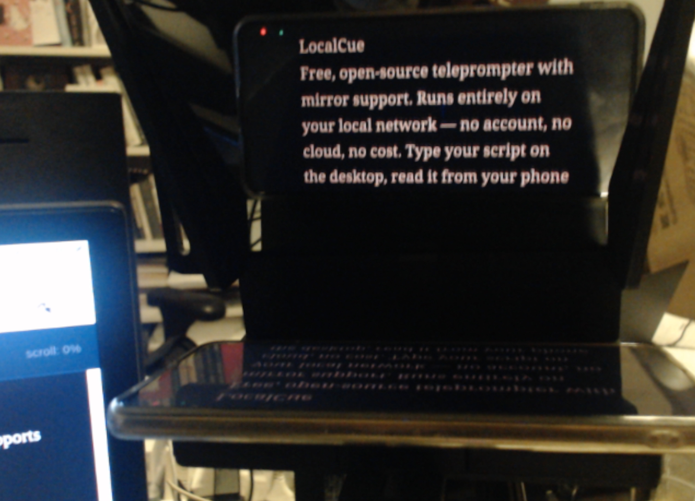

# LocalCue

**Free, open-source teleprompter with mirror support.** 
Runs entirely on your local network — no account, no cloud, no cost. 
Type your script on the desktop, read it from your phone over Wi-Fi. Supports teleprompter mirrors (horizontal flip), real-time sync, auto-scroll, and one-click seek. Up and running in minutes.





## Requirements

- Python 3.8+
- [uv](https://docs.astral.sh/uv/getting-started/installation/) — `curl -LsSf https://astral.sh/uv/install.sh | sh`

All Python dependencies are declared inline in `app.py` and installed automatically by `uv` on first run.

## Quick Start

```bash
git clone git@github.com:mdda/localcue.git
cd localcue
uv run app.py              # start with an empty script, or…
uv run app.py script.txt   # load script.txt, and enable Save (Ctrl+S) back to it
```

If the script file doesn't exist yet, it is created the first time you save. Without a file argument, the script lives only in the browser/server memory (it survives a desktop page reload, but not a server restart).

The terminal prints two URLs:

```
Desktop: http://localhost:5858/
Mobile:  http://192.168.x.x:5858/view
```

Open the Desktop URL in your browser. Scan the QR code (click the **QR Code** button) with your phone to open the mobile view.

> **Firewall note:** If your phone cannot reach the desktop machine running `uv run app.py`, open port 5858 in its firewall:
> - **Fedora/RHEL:** `sudo firewall-cmd --add-port=5858/tcp --zone=public`
> - **Ubuntu/Debian:** `sudo ufw allow 5858`
> - **macOS:** System Settings → Network → Firewall → Options → allow incoming connections for Python (or disable the firewall for trusted home networks)
> - **Windows:** Windows Defender Firewall will prompt when the app first runs — click **Allow**. Or manually: `netsh advfirewall firewall add rule name="Teleprompter" dir=in action=allow protocol=TCP localport=5858`

## Mobile Setup — Fullscreen via "Add to Home Screen"

The mobile view (`/view`) is designed to run fullscreen so the browser address bar does not eat into the display area.

**Quick fullscreen (Android Chrome):** tap anywhere on the mobile display to toggle fullscreen on/off. A faint "tap for fullscreen" hint appears briefly on load as a reminder.

**Persistent fullscreen via Add to Home Screen (Android Chrome):**
1. Open the mobile URL in Chrome.
2. Tap the three-dot menu (⋮) in the top-right corner.
3. Tap **Add to Home Screen**.
4. Accept the prompt.
5. Open the app from your home screen — it launches fullscreen with no browser chrome.

**On iOS (Safari):**
1. Open the mobile URL in Safari.
2. Tap the Share button (box with arrow).
3. Tap **Add to Home Screen**.
4. Open it from your home screen for fullscreen display.

## Controls (Desktop)

| Control | Description |
|---|---|
| **QR Code** | Shows a scannable QR code and URL for the mobile view — close with **Esc**, click outside, or the Close button |
| **💾 Save** (Ctrl+S) | Writes the script back to the file given on the command line (only shown when a file was given). The filename beside it shows **●** when there are unsaved edits |
| **⟳ Reload** | Re-reads the script file from disk — use after editing it in another editor (asks first if you have unsaved edits) |
| **Font size** slider | Sets text size on the mobile display (16–96 px) |
| **\| side margins \|** slider | Sets horizontal padding on the mobile display (0–40%) |
| **↔ Flip** | Toggles left-right mirror on mobile (highlighted = mirrored, for use with a teleprompter mirror) |
| **☀ Brightness** slider | Dims the white text on mobile (0–100%) — useful if bright text reflects in glasses |
| **▶ Play / ⏹ Stop** | Toggles Play Mode — see below |
| **⇄ Speed** slider | Auto-scroll speed in px/s on the mobile display (1–100, default 30) |
| **🎤 Voice** | Voice-follow on/off — the script keeps up with what you say (see below). The words it hears are shown beside it |
| **position: N%** | Shows your current position through the script (by characters) |

## Scroll Control

### Reading line

Both the desktop editor and the phone show a thin red **reading line** one third of the way down the screen, so you can see some lead-in above it and what's coming below. The line just under the rule is the *same text* on both devices — the position is tracked as a character offset in the script, and each device maps that to its own line wrapping (the wide desktop editor and the narrow phone wrap lines differently).

### Mouse wheel

Scroll the mouse wheel anywhere on the desktop page: the editor scrolls, and the phone follows so the same text stays on both reading lines. (Scrolling the editor any other way — scrollbar, keyboard — does the same.) The speed depends on horizontal mouse position:

| Mouse position | Behaviour |
|---|---|
| Left 25% of screen | Normal scroll speed |
| Right 75% of screen | Progressively finer, down to 1/5 speed at the right edge — for precise positioning |

### Click to seek

**Click a line in the desktop editor** to put it on the reading line on both the desktop and the phone — handy for resuming after editing.

## Play Mode

Click **▶ Play** to enter Play Mode. Arrow keys then control auto-scroll instead of moving the desktop cursor.

| Key | Action |
|---|---|
| `↓` (when paused) | Start auto-scrolling at the current speed |
| `↓` (while scrolling) | Skip forward ~2 seconds of movement |
| `↑` (while scrolling) | Pause — no position change |
| `↑` (while paused) | Skip back ~6 seconds of movement |
| `←` / `→` | Decrease / increase speed by 5 |

The auto-scroll runs on the phone itself (smooth, unaffected by WiFi hiccups), and the desktop editor follows along. The speed slider (1–100) represents pixels per second on the mobile display, so the same value feels consistent regardless of script length. At the default of 30 px/s with a 36 px font, the scroll rate is roughly 0.5 lines per second — comfortable reading pace.

A status indicator next to the slider shows **▶ playing** (green) or **⏸ paused** (amber) while in Play Mode.

Click **⏹ Stop** to exit Play Mode and restore normal arrow-key behaviour in the textarea.

## Voice-Follow

Click **🎤 Voice** and just start reading — no need to pick a scroll speed. The server listens to the microphone, recognises your speech **locally** (nothing leaves your machine), and moves the script so the line you're reading sits on the reading line. The phone glides to each new position rather than jumping.

It is deliberately loose, to suit reading from a script while riffing a little:

- **Fluffs:** if you repeat the previous line(s), it follows you back, then on again.
- **Riffing / bullet points:** off-script speech doesn't match, so the script simply waits for you to come back to it.
- **Skipping ahead:** it searches a few hundred characters ahead of the current position (matches further ahead need to be more convincing).
- **Manual control still works:** scroll or click to reposition at any time — voice-follow forgets what it heard and carries on from the new position. A typical start: scroll to the right place, click 🎤 Voice, start reading.

Details:

- Speech recognition is [Vosk](https://alphacephei.com/vosk/) with its small English model (~40 MB), downloaded to `~/.cache/vosk` the first time you click 🎤 Voice. After that, the first click in each server run takes a few seconds to load it; toggling off and on again is instant.
- Audio is captured through PulseAudio's API — on modern Linux that is PipeWire's `pipewire-pulse`. It uses your default input; to pick another, pass `--mic SOURCE` (list sources with `pactl list short sources`).
- To use a different (e.g. larger, more accurate) Vosk model: `--vosk-model NAME` (downloaded automatically) or `--vosk-model /path/to/model-dir`.
- The matching ideas (phonetic word codes so homophones match, word-level fuzzy matching, a penalty on distance ahead) are adapted from [promptme-ai](https://github.com/larsbaunwall/promptme-ai).

## Screen Wake Lock (Mobile)

The mobile view requests a [Screen Wake Lock](https://developer.mozilla.org/en-US/docs/Web/API/Screen_Wake_Lock_API) on load, on each fullscreen tap, and every 30 seconds as a fallback — preventing the screen from dimming during a take. A small dot in the top-right corner of the mobile view shows the lock status:

| Colour | Meaning |
|---|---|
| Blue | Wake lock is active |
| Red | Wake lock failed or not supported |
| Grey | Pending (page just loaded) |

**If the dot is red on Android:** the browser's battery optimisation is blocking the API.
- Settings → Apps → (your browser) → Battery → **Unrestricted**
- Settings → Battery → Battery Saver → **Off**

**If the dot is red on iOS Safari:** the Wake Lock API is not supported. Use Chrome for iOS (iOS 16.4+), or add the page to your Home Screen as a PWA.

**Reliable fallback (any device):** Settings → Display → Screen timeout → **Never** (safe when plugged in).

## Workflow

1. **Prepare:** paste or type your script in the desktop textarea.
2. **Set up mobile:** scan the QR code, open the link, add to home screen, launch fullscreen.
3. **Adjust:** use the sliders to set font size, margins, and brightness to suit your lighting and mirror.
4. **Flip:** confirm the **↔ Flip** button is highlighted (mirrored) if you are using a physical teleprompter mirror; un-flip for direct reading without a mirror.
5. **Position:** click a line in the desktop editor to put it on the reading line on both screens.
6. **Record:** click **🎤 Voice** and just read (the script follows you), or use Play Mode (▶) with arrow keys for fixed-speed auto-scroll, or scroll manually with the mouse wheel.
7. **Recover:** if you lose your place, press **↑** to pause, then click the correct line in the desktop textarea to seek back to it.
